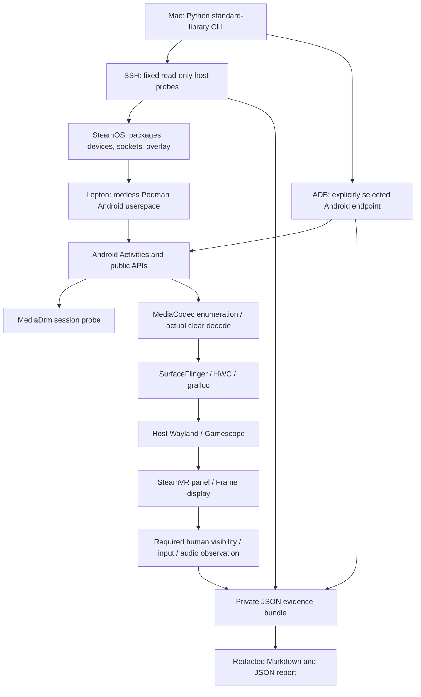

# Architecture

The host compositor and protected-media route are investigation targets, not established implementations. MediaDrm, decoding, allocation, import and final visible presentation are separate evidence boundaries.

## Modules

| Module | Responsibility |
|---|---|
| `lab/core.py` | Typed config, subprocess timeouts/quoting, private bundles, target binding, redaction |
| `lab/collect.py` | Fixed host/Android probes, scoped snapshots, export validation |
| `scripts/inspect/` | Python standard-library scripts sent through SSH stdin, no remote files written |
| `lab/apk.py` | Bounded ZIP + binary/text manifest parsing, aliases/splits/ABI hints |
| `lab/actions.py` | Explicit install, resolve and launch operations |
| `lab/compare.py` | Relevant exact-path component hash comparison |
| `lab/reports.py` | Conservative interpretation, service classification and reports |
| `lab/workflow.py` | Ten checkpointed stages and human observations |
| `lab/synthetic.py` | Explicit offline fixtures; cannot write into live bundles |
| `lab/media.py` | Generated clear patterns via installed ffmpeg |
| `android/` | Three independent native Java Activities; no external Android libraries |

Transport methods distinguish LOCAL MAC COMMAND, REMOTE FRAME COMMAND and ANDROID GUEST COMMAND in saved records. Local commands use argument arrays. SSH and Android shell arguments use `shlex.join`; user input never becomes an unquoted command fragment. Fixed shell probes handle platform globbing. Every tool command has a timeout; failures, stderr, truncation and unavailable probes remain evidence.

## Evidence model

A bundle has schema version 1 and an immutable synthetic/live classification. `metadata.json` records UTC time, toolkit version, Git revision if available, local architecture, redacted config, Frame identity, errors, completed/skipped stages. `target.local.json` is a separate private transport binding: changing host/context is refused; a changed ADB endpoint requires an explicit assertion that it targets the same Frame/context. It must not be shared.

Subdirectories separate host, Lepton, Android, DRM, codec, media, service and log evidence. Each probe preserves status and stderr; missing permission/command is not absence of a hardware capability. JSON has stable sorted keys. Timestamps/run IDs remain intentionally variable; compare report fields or normalise those fields for diffs.

The diagnostic app exports a unique completed run ID. The media app invalidates old exports at Activity launch, identifies launch and playback runs separately and serialises decoder ownership. The workflow rejects stale exports. Files are saved atomically. Failed/paused stages are retried; successful/skipped stages remain complete until `--retry-stage`. Retrying an observation stage clears only its own answers.

## Overlay mapping and comparison

The source's `setup_mounts()` binds regular files from `images/rootfs_overlay` and `/usr/share/guestos/android` individually. It does not explicitly select a duplicate-destination winner. APEX activation and consuming-process mount namespaces can change effective visibility.

Inspection inventories file type, size, permissions, UID/GID, owner/group, SHA-256 and available package ownership. Secret-like files and nonregular files are not opened or hashed. Hashing is bounded; oversized files and permission failures are explicit. Component names are search hints only. `inspect --containers` captures only selected Podman fields, avoiding environment and complete configuration dumps. `collect --pid PID` can gather a specified process's mountinfo and library paths without memory addresses or data maps.

`effective-components` hashes at most 100 relevant `.so` paths in the ADB-shell namespace. Compare exact paths and hashes with the recorded mount destinations. A matching hash is a content match, not proof of mount provenance or protected behavior. Read the consuming service's namespace for an APEX claim.

The public source archive has no built rootfs. Therefore missing exact public-overlay counterparts are `UNKNOWN`; they are never falsely promoted to `HOST-ONLY`/proprietary. `SAME` and `DIFFERENT` refer only to exact public-overlay file bytes. A full shipping-base/effective/APEX ownership audit still requires access to the relevant shipping paths and namespaces. No blanket byte comparison or image extraction is performed.

## Future Steam launch UX

Source feasibility: `compat_tool/toolmanifest.vdf` dispatches a Steam launch verb; `lepton start /absolute/app.apk` accepts an APK; `APP_WANTS_FLATSCREEN=true` requests the ordinary Android window except for applicable headless overrides. `am start -n package/activity` bypasses a narrow manifest extractor that may miss aliases. Context/compatdata preserve some app state, while process-observer lifetime and external login callbacks need tests.

After one service proves useful, a small per-service wrapper could select its persistent context, start the correct APK/Activity, request flatscreen presentation and expose it as a Steam shortcut. Panel placement, focus, controller input, Back/Home, account persistence, login callbacks, suspend and exit behavior must all be proven first. ACTION_VIEW interception may redirect login callbacks to the host. A wrapper cannot establish DRM trust, certification or secure composition. The polished launcher is intentionally not implemented.

Source paths were verified in the supplied `../Lepton/` archive. The report's old `lepton-main` absolute links and parent-level CI layout differ from today's folder layout; no contradictory runtime behavior was found in the launcher/mount paths checked.
