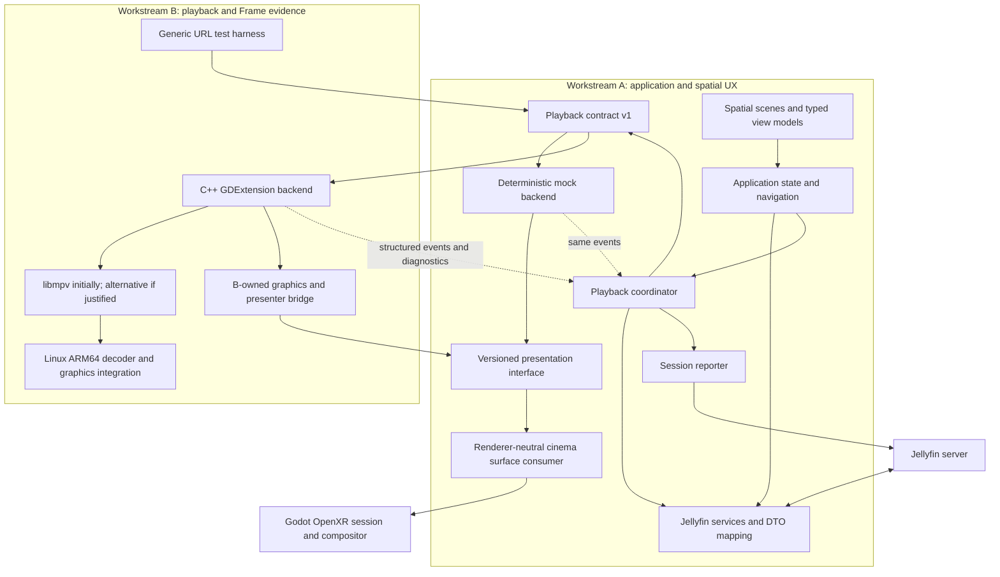

# Spatial Jellyfin client: technical design and implementation milestones

**Date:** 15 October 2026

**Revision:** 4 November 2026 — VideoFrameVR added to E0 as a playback benchmark and secondary app candidate alongside FramePlayerX.

**Status:** Design for review; implementation is not authorised by this document.

**Location:** Kept with the existing investigation documentation. The repository layout below describes a future application repository; it does not restructure Frame Media Lab. No application name is selected.

## 1. Executive summary and architectural decisions

Build a small, polished spatial Jellyfin client whose application can be developed and verified before Steam Frame hardware decoding works. Develop the native playback pipeline in a separate test harness, then connect it through one versioned contract. The first integrated demonstration is one complete Jellyfin viewing session; high-quality 4K readiness is a subsequent, explicitly measured gate.

**New decision gate:** Evaluate FramePlayerX and VideoFrameVR before A1 and before committing to the Godot build. FramePlayerX is the closer Jellyfin-library candidate; VideoFrameVR is a playback benchmark and secondary app candidate. E0 (§12) compares using an existing application, adapting it, and building this client. The Godot choices below remain the previously agreed build direction, conditional on that comparison; E0 does not itself select a replacement architecture. Sections 2–10 and the later implementation milestones describe the Godot branch if it is selected. No implementation or evaluation execution is authorised by this documentation update.

| Status | Decision |
|---|---|
| **Decided — Godot build option, subject to E0** | New Godot application; selective reuse of suitable JellyVR components, not a whole-client fork. |
| **Decided** | Typed GDScript for application/domain/UI; dedicated Jellyfin REST/WebSocket integration; replaceable C++ playback through GDExtension. |
| **Decided** | OpenXR first, Steam Frame initial target, open-source project. No Android/Lepton dependency for this native Linux client. |
| **Decided** | Workstream A runs with mock playback and must not load a native extension to start. Workstream B accepts generic media requests and knows nothing about Jellyfin. |
| **Decided — architectural constraint** | A depends only on the versioned playback/presentation contract and mock backend, never on B's decoder, renderer, graphics API, texture transfer or native dependencies. B implements that contract independently; changing its internals must not require changes to Jellyfin services, navigation or library UI. |
| **Proposed** | One application repository, one application state owner, one playback coordinator, one native extension initially. Avoid a plugin marketplace, service container, generated whole-server SDK or general-purpose event bus. |
| **Proposed** | Initial product: one server/user, Continue Watching, Recently Added, movie/episode details, Play/Resume, restrained cinema, pause/seek/stop, return to the same library position. |
| **Proposed** | Start the native investigation with libmpv, retaining a backend contract suitable for an FFmpeg/V4L2 implementation if measured integration problems justify it. |
| **Proposed — internal to B** | Godot Mobile/Vulkan is the initial native harness renderer candidate. B owns decoder, renderer and graphics interoperability experiments; A's mock development neither waits for nor imports those choices. Integration must validate the chosen configuration against the stable presentation contract. |
| **Proposed — explicit approval pending** | GPL-3.0-or-later is the recommended project licence, not an approved licence. Session-only authentication is a proposed initial security fallback; secure persistent authentication remains desirable. |
| **Unresolved** | Actual Frame decoder access, codecs/profiles, efficient texture transfer, audio route, thermals, sustained performance, HDR presentation and shipping runtime permissions. |
| **Proposed — evaluate before A1** | Compare FramePlayerX and secondary candidate VideoFrameVR against the product need, using VideoFrameVR also as a playback benchmark. Decide whether use, bounded adaptation or the Godot build is justified by recorded gaps and evidence. |

Initial scope excludes search, full library traversal, collections, series/season navigation, multiuser selection, downloads, live TV, SyncPlay, remote control, elaborate environments and multi-platform releases. Those remain product ambitions, not prerequisites for the first useful vertical slice. Individual episodes already returned in the two home rows can be played and show series/season/episode labels.

Evidence remains governed by [CONTEXT.md](../CONTEXT.md). **No physical Frame tests have been performed by us.** Third-party Lepton reports strengthen concern about the default Android hardware-decoding path. Separate native/custom V4L2 reports justify investigation, not a performance promise. The three lab APKs remain runtime **NOT TESTED**. Widevine, secure decoding, ordinary Android 2D presentation and commercial-service playback remain **UNKNOWN**; the shipping-component hypothesis remains an architectural possibility. Clear Jellyfin playback does not answer those DRM questions.

### Implementation depth and sequencing

The detailed contracts and policies below describe the intended design, not a requirement to implement every case in M0 or A1. Apply them progressively:

| Category | Required depth and timing |
|---|---|
| **Architectural requirements** | Define ownership, versioned boundaries, event ordering, instance identity, terminal resource release and capability semantics in M0. Enforce these invariants from the first implementation; keep Jellyfin and native playback separate. |
| **Initial implementation requirements** | A1 implements only a mock-only navigation/playback slice with load/ready/play/pause/position/end/stop, basic failure cleanup and focused ownership/order tests. Optional operations can report unsupported through capabilities. No networking, persistent state, native code or comprehensive failure simulator is needed. |
| **Incremental hardening** | A2 adds authentication, bounded/cancellable requests, safe parsing and basic artwork loading/cache as those features appear. A3 adds the fuller mock scenarios, seek/reporting, persistence, WebSocket/reconnection, retry/cache policies and remaining A acceptance tests. B1 hardens real native resources/interop; B2/B3 add sustained measurements. Complete the existing admission gates before I1. |

Security and lifecycle correctness are not optional hardening: credentials must be protected/redacted when authentication is introduced; real buffers must have safe ownership/release when native playback is introduced. Rich fault injection, exhaustive permutations, optional instrumentation and cache/retry refinements can follow the first working slice. M0 defines their semantics and destination milestone without implementing them. Unsupported or unavailable features remain explicit, never simulated as successful native capabilities.

## 2. System architecture



There is **one Godot-owned OpenXR session per running application or harness**. B's harness supplies its own minimal scene, camera, video surface and XR actions; the playback library does not create a competing XR instance/session. Harness and application consume the same presentation contract, not a native presenter implementation shared into A. A uses a mock surface; B supplies its own bridge. The video display remains independent of library UI rendering.

Control/events cross the GDScript/C++ boundary only in B's adapter and the admitted integration build; full video frames do not cross as GDScript byte arrays. B's native presenter bridge owns GPU-resource interchange. A receives capabilities and a renderer-neutral video surface, with no Vulkan/OpenGL handles, fences or decoder buffers. An event carrying a surface does not imply zero-copy, correct colour or hardware decode: those have separate diagnostics and gates.

## 3. Proposed repository structure

This is a **proposed future single repository**, not directories to create during this planning task.

```text
spatial-jellyfin/                  # working placeholder, not a chosen product name
  app/
    project.godot
    bootstrap/                    # dependency construction, backend selection
    domain/                       # typed application models, no networking/UI
    jellyfin/
      transport/                  # HTTP, WebSocket, authentication headers
      dto/                        # JSON validation and conversion only
      services/                   # auth, library, artwork, playback negotiation
      reporting/                  # Jellyfin session/report state
    application/                  # state, navigation, playback coordinator
    ui/
      components/                 # poster card, row, buttons, status panels
      screens/                    # connect, home, details, cinema controls
      view_models/                # display-ready typed state and actions
    xr/                           # rig, actions, spatial layout, recenter
    playback/
      contract/                   # versioned neutral playback/presentation definitions
      mock/                       # deterministic clock and scripted failures
      presentation/               # renderer-neutral surface consumer and mock display
    platform/                     # Frame config and credential-store adapter
    addons/                       # pinned XR Tools and development-only GUT
  integrations/
    native_playback/              # B-owned opt-in adapter/registration/export settings
  native/                         # B-owned; not imported by A's mock build
    include/playback/             # C++ neutral contract and transport structs
    src/backend_mpv/              # mpv commands, events, audio, tracks
    src/presentation/             # texture ownership and graphics synchronisation
    src/platform/linux/           # actual Frame-specific decoder/interop needs
    src/godot/                    # thin GDExtension registration and bindings
    CMakeLists.txt
  harness/                        # Godot scenes + manifests, generic URLs/files
  tests/
    unit/                         # domain/DTO/services/navigation tests
    contract/                     # traces applied to mock and native adapters
    integration/                  # mock HTTP server, opt-in real-server tests
    fixtures/                     # synthetic/redacted API and media manifests
    native/                       # lifecycle, queue and resource tests
    device/                       # reproducible manual procedures and templates
  scripts/                        # build/check/package; no implicit installation
  third_party/                    # dependency manifest, licences, reuse ledger
  docs/                           # design, API baseline, contract, build, tests
  .github/workflows/              # modest CI checks; never deploy by default
  README.md
  CONTRIBUTING.md
  SECURITY.md
  LICENSE
```

Keep scenes next to their scripts and introduce directories only when used. Do not create an empty alternative FFmpeg implementation or speculative platform hierarchy. Test dependencies must be excluded from release exports. Frame Media Lab remains a separate evidence toolkit.

The contract definitions are consumable without loading application services or native code. B's harness uses those definitions plus its own adapter; it does not wait for A1 or reuse A's bootstrap. A's mock build excludes `native/` and `integrations/native_playback/`, including static GDExtension class references and preloads. Only the integration build registers the B-owned provider at the bootstrap boundary. Keep renderer/export configuration there rather than adding graphics branches to library scenes or services.

## 4. Subsystem responsibilities and interfaces

| Subsystem | Owns and exposes | Must not own |
|---|---|---|
| Bootstrap | Constructs services, accepts a contract-compatible provider; mock by default, native registered only by the integration build | Native imports in A, runtime business state or hidden global singletons |
| Transport | Cancellable requests, bounded concurrency, status/error mapping, credentials, connection generation | UI navigation or automatic playback fallback |
| Jellyfin services | `connect`, `authenticate`, `get_resume_page`, `get_latest`, `get_item`, `get_artwork`, `negotiate` | Native player objects or scene nodes |
| Application state | Current server/user, route stack, row focus/scroll, request cancellation scopes | Raw JSON or video decoding |
| Playback coordinator | One logical viewing session; negotiation, instance ownership, commands, recovery/fallback | Decoder internals or HTTP transport implementation |
| Session reporter | Maps accepted playback observations to Jellyfin start/progress/stop, ordered delivery state | Invented playback time, independent retry-to-play decisions |
| UI/view models | Typed display state, user intents, accessibility/focus; renderer-neutral surface consumption | HTTP calls, tokens, mpv properties or graphics API decisions |
| XR layer | Reference space, actions, pointer/focus, comfortable placement | Jellyfin IDs or codec policy |
| Backend | Media loading, clock, tracks, decode, audio, seek, execution events | Jellyfin device profiles, users, item IDs or reporting |
| Presentation interface | Portable surface metadata, opaque Godot-facing surface reference, capabilities and release semantics | Native graphics handles, fences, buffer layouts or platform-specific implementation requirements |
| Presenter bridge (B) | Persistent texture resources, colour conversion, synchronisation and release behind that interface | Authentication, application navigation or a second playback lifecycle |

GDScript services use typed `RefCounted` models and explicit asynchronous request handles with completion/failure signals. Cancellation invalidates the consumer generation even if an underlying request has already completed. Scene destruction cancels subscriptions; late responses cannot populate a different user's screen. Use one application root as composition/state owner, not a collection of mutable autoload managers.

Only the coordinator turns a user Play intent into negotiation and backend execution. Only the reporter sends Jellyfin playback reports. B's harness uses the backend directly and has no reporter at all.

## 5. Typed domain models

All definitions here are design schemas, not implemented code. `?` denotes an optional value in this document, not GDScript syntax. Implement optional scalars with an explicit presence flag or small typed wrapper; never use `0` to mean unknown duration, decoder load or frame count. Use GDScript `int`/C++ `int64_t` for time and counters; typed arrays for collections. Dictionaries are confined to JSON parsing, HTTP header maps and the small, validated GDExtension wire adapter.

Introduce each model when its consuming feature is implemented. A1 needs only placeholder navigation and basic mock playback models; this catalogue is not an instruction to implement Jellyfin/session/cache models before A2/A3.

| Model | Minimum fields |
|---|---|
| `ServerIdentity` | Normalised base URL including path prefix; server ID/name/version; connection generation |
| `AuthenticatedUser` | User ID, display name, server ID; no password/token in UI model |
| `CredentialRef` | Opaque credential-store handle; session-only flag; never a serialisable token in app state |
| `ItemSummary` | ID, kind (`MOVIE`, `EPISODE`, `UNSUPPORTED`), title, year?, duration?, image refs, user progress; optional series/season/episode labels |
| `ItemDetails` | Summary, overview, genres, rating?, media versions/stream descriptors needed for negotiation |
| `UserProgress` | Resume position, played state, last-played time?; received server revision/time for cache freshness |
| `ArtworkRef` | Server/user scope, item/image-owner ID, image type/index, image tag?, aspect ratio? |
| `ItemPage` | Typed items, start index, total?, has-more; latest row uses a bounded list rather than invented pagination |
| `NavigationSnapshot` | Route, item ID?, row ID, focused item ID, scroll anchor/offset; no scene-node references |
| `AppError` | Category, safe user message, retryability, request correlation ID; raw server bodies excluded |
| `NegotiatedPlayback` | Jellyfin-only item/media-source/play-session IDs, play method, stream request, stream-index mapping, timeline mapping, profile ID, transcode reasons |
| `ViewingSession` | App-generated logical ID, server/user scope, active backend instance, report state, last confirmed item position, return navigation snapshot |
| `PlaybackRequest` / `PlaybackEvent` / `BackendCapabilities` | Backend-neutral types defined in §7; contain no Jellyfin IDs or DTOs |

Jellyfin uses 100-nanosecond ticks. Convert at the integration boundary to signed 64-bit microseconds (`ticks / 10`); reports convert back (`microseconds * 10`) with overflow/range checks. Fractional timestamps from native libraries are normalised once. Preserve absent metadata; display placeholders rather than coercing missing values into false facts.

The negotiated stream may begin at an item offset. Keep **item time** and **stream time** distinct: direct-file seek normally maps identically; a transcode started at an offset may reset its stream clock. `TimelineMapping` records that offset and any discontinuity; the coordinator reports item time and avoids applying the requested resume offset twice. This mapping requires integration fixtures and a real transcode test.

## 6. Jellyfin API integration design

### 6.1 Baseline and minimum surface

**Proposed:** Use the official [OpenAPI documentation](https://api.jellyfin.org/) and the [v12.2 server source](https://github.com/jellyfin/jellyfin/tree/v12.2) as the initial design baseline, checked on 15 October 2026. Before implementation, record the actual test server version and pin its schema/source revision. Supporting Sean's installed server version is a gate; v12.2 is not an assertion about his server. Test only an explicit compatibility matrix, initially one server version plus the fake server. Add an older route adapter only if the chosen supported server requires it. Do not scatter version conditionals through UI code.

All routes are relative to the configured base path. HTTP fields below use the official DTO/query spelling; parameter/body details are verified against the pinned schema during implementation.

| Purpose | Required route / minimal request | Official source |
|---|---|---|
| Identify/validate manually entered server | `GET /System/Info/Public`; server ID/version, setup/availability check | [SystemController](https://github.com/jellyfin/jellyfin/blob/v12.2/Jellyfin.Api/Controllers/SystemController.cs) |
| Authenticate and restore user | `POST /Users/AuthenticateByName` with JSON `Username`, `Pw`; `GET /Users/Me` for stored-token validation | [UserController](https://github.com/jellyfin/jellyfin/blob/v12.2/Jellyfin.Api/Controllers/UserController.cs) |
| Continue Watching | `GET /UserItems/Resume` with `userId`, `startIndex`, `limit`, video/item filters and required image/user-data fields | [ItemsController](https://github.com/jellyfin/jellyfin/blob/v12.2/Jellyfin.Api/Controllers/ItemsController.cs) |
| Recently Added | `GET /Items/Latest` with `userId`, `limit`, `includeItemTypes=Movie,Episode`, `groupItems=false`, image/user-data fields | [UserLibraryController](https://github.com/jellyfin/jellyfin/blob/v12.2/Jellyfin.Api/Controllers/UserLibraryController.cs) |
| Details | `GET /Items/{itemId}?userId=…`; use returned metadata, not a second catalogue API | [UserLibraryController](https://github.com/jellyfin/jellyfin/blob/v12.2/Jellyfin.Api/Controllers/UserLibraryController.cs) |
| Artwork | `GET /Items/{itemId}/Images/{imageType}` with image index when needed, `tag`, bounded `maxWidth`/`maxHeight`, supported format | [ImageController](https://github.com/jellyfin/jellyfin/blob/v12.2/Jellyfin.Api/Controllers/ImageController.cs) |
| Negotiate source and delivery | `POST /Items/{itemId}/PlaybackInfo`; body includes `UserId`, `DeviceProfile`, `StartTimeTicks`, selected media/audio/subtitle indices, bitrate limit and direct/transcode flags | [MediaInfoController](https://github.com/jellyfin/jellyfin/blob/v12.2/Jellyfin.Api/Controllers/MediaInfoController.cs), [PlaybackInfoDto](https://github.com/jellyfin/jellyfin/blob/v12.2/Jellyfin.Api/Models/MediaInfoDtos/PlaybackInfoDto.cs) |
| Fetch media | Use negotiated delivery URL when supplied; otherwise construct the documented `/Videos/{itemId}/stream` static route for an approved direct-play source, including its source ID | [VideosController](https://github.com/jellyfin/jellyfin/blob/v12.2/Jellyfin.Api/Controllers/VideosController.cs) |
| Session reports | `POST /Sessions/Playing`, `/Sessions/Playing/Progress`, `/Sessions/Playing/Stopped` | [PlaystateController](https://github.com/jellyfin/jellyfin/blob/v12.2/Jellyfin.Api/Controllers/PlaystateController.cs) |
| Transcode liveness | `POST /Sessions/Playing/Ping?playSessionId=…` only when maintaining a negotiated transcode session; stop report closes its job in this baseline | [PlaystateController](https://github.com/jellyfin/jellyfin/blob/v12.2/Jellyfin.Api/Controllers/PlaystateController.cs) |
| Session capabilities/logout | `POST /Sessions/Capabilities/Full` with truthful limited capabilities; `POST /Sessions/Logout` on explicit logout | [SessionController](https://github.com/jellyfin/jellyfin/blob/v12.2/Jellyfin.Api/Controllers/SessionController.cs) |
| Freshness and connection events | Authenticated WebSocket at base-path `/socket`; keepalive, library/user-data changes, server restart/shutdown | [WebSocket manager](https://github.com/jellyfin/jellyfin/blob/v12.2/Emby.Server.Implementations/HttpServer/WebSocketManager.cs), [session listener](https://github.com/jellyfin/jellyfin/blob/v12.2/Emby.Server.Implementations/Session/SessionWebSocketListener.cs) |

Manual URL entry and remembered server are sufficient initially. Discovery means identifying that server via public info; automatic LAN broadcast discovery is deferred. Preserve reverse-proxy base paths, validate schemes, reject embedded user/password URL credentials, and never guess the server address. [Jellyfin networking documentation](https://jellyfin.org/docs/general/post-install/networking/) describes base paths and discovery separately.

No initial APIs for admin, search, collections, live streams, playlists, provider accounts or explicit mark-watched edits. Do not use live-stream open/close endpoints for ordinary files. If playback negotiation requires an unsupported live/open-token source, report it as unsupported rather than accidentally expanding scope.

### 6.2 Authentication, transport and cache

A2 starts with secure authentication, finite timeouts, cancellation, bounded artwork storage and manual retry. Add the fuller concurrency, automatic retry and cache refinement policies below in A3; they are not M0/A1 infrastructure prerequisites. Security, response validation and user/session isolation apply as soon as networking exists.

Use a stable random installation device ID, client/version/device identity and the documented Jellyfin authorisation header. Encode JSON through Godot's JSON API, not string concatenation. Prefer header tokens for HTTP, media and native WebSocket handshake. Do not log headers, credentials, signed query strings or full playback URLs. If a protocol requires a token-bearing URL, keep it in memory and redact it at every diagnostic boundary. Cross-origin redirects must never inherit Jellyfin credentials automatically; authentication origin policy is part of `PlaybackRequest`.

**Proposed security policy — explicit approval pending:** tokens live in memory until a functioning platform credential store is established. Session-only authentication is an acceptable proposed initial fallback, not a permanent product limitation; persistent authentication remains desirable once suitable secure storage is verified. Persist only a credential-store reference if a usable Linux Secret Service or equivalent is verified on Frame. Otherwise the app restores server/navigation state and asks for login on restart. Do not disguise a bundled encryption key or ordinary Godot config file as secure storage. Passwords are never persisted. HTTPS certificate validation stays enabled. Explicitly configured trusted-LAN HTTP is a supported user choice whose connection UI explains that traffic is unencrypted; no automatic TLS downgrade. Logout clears local credentials and cached user state even if the server request fails.

Use a bounded `HTTPRequest` pool, never simultaneous requests through one node. Proposed initial policy: four small API requests, two artwork downloads, 15-second API timeout, 30-second artwork/negotiation timeout, cancellation on navigation/user change. These are adjustable responsiveness safeguards, not server-performance guarantees. Retry read-only transient failures with jittered 1/2/4-second delays, honour `Retry-After`, then show Retry. Do not retry bad credentials, certificate errors or malformed responses automatically. Godot exposes cancellation and timeout controls in [HTTPRequest](https://docs.godotengine.org/en/stable/classes/class_httprequest.html).

Resume pages initially contain 20 items with `startIndex` pagination and ID deduplication; refresh page zero on returning from playback. Latest is a bounded 20-item row: that endpoint has no `startIndex`, so no fabricated paging. A future full library screen would add a paginated `/Items` query. Request only necessary fields; ignore additive JSON fields but reject missing required IDs or invalid types with typed errors.

Artwork cache key: server ID + user scope + image owner/type/index + tag + requested size/format. Use bounded disk LRU and memory texture LRU; proposed starting caps 256 MiB and 64 MiB, measured on device before retaining them. Decode only bounded image dimensions, reuse visible textures, cancel offscreen downloads and prioritise visible cards. Tags invalidate changed art; tagless responses need revalidation/TTL. Cache metadata briefly with a visible stale/offline state, but revalidate playback permissions and URLs before Play. Purge user-private data on logout/server change. Cache budgets are safety limits, not desired steady-state consumption.

### 6.3 Negotiation, session accuracy and reconnection

Build `DeviceProfile` from the selected backend's capability snapshot plus **verified platform limits**. A codec compiled into FFmpeg is not proof of usable Frame 4K hardware playback. Keep separate direct-play container/video/audio/subtitle rules, remux rules and transcode output rules. Begin conservatively with the tested 1080p AVC/AAC path; increase limits only after B's evidence. Do not advertise HDR, bitstream audio or AV1 from chipset marketing. Mock profiles are explicitly synthetic and never reused as native profiles.

The Jellyfin service maps negotiation into a generic request and retains item/source/play-session IDs, actual play method and track mapping outside the backend. Prefer direct play when verified; permit remux/audio conversion when appropriate; allow server transcoding into a tested format under user policy. Resolve relative delivery URLs against the configured server correctly. Never use a server filesystem `Path` as a client URL. A failed direct-play attempt can trigger **one** coordinator-owned renegotiation, using its last confirmed item position and a downgraded profile; do not allow a retry loop that repeatedly changes quality.

Reporting state is separate from native execution state, but derived from it:

1. Negotiation/load alone sends no start. First accepted `Playing` observation produces one logical start report for that backend attempt and the negotiated `PlaySessionId`.
2. Proposed progress cadence is every 10 seconds while active, plus confirmed pause/resume/seek/track changes. This balances request volume with useful resume accuracy; it is not a Jellyfin protocol requirement. Use observed position, `IsPaused`, `CanSeek`, selected Jellyfin stream indices and negotiated play method. Never advance position from wall time during buffering.
3. `Ended`, user stop, fatal error and app exit each converge on one logical stop with the final confirmed position; `Failed` reflects execution failure. A pre-start failure still releases any negotiated transcode session. Never mark watched merely because Play was pressed or because the mock elapsed a duration on a production account.
4. The reporter serialises start before progress before stop and coalesces pending progress. HTTP delivery is not exactly-once: uncertain timeout outcomes remain uncertain. Bound retries within the current session; stop retries before starting a replacement attempt for the same item so stale reports cannot overwrite newer progress. Do not replay historical reports after a restart.
5. During a short network loss, local playback may continue from buffer while reports show pending status. On reconnection, send the latest current position, not every queued tick. If playback cannot recover, stop and offer Retry. Long outages and a crash can lose unacknowledged progress; state that honestly and re-fetch server progress on restart.

The reporter uses Jellyfin's [progress DTO](https://github.com/jellyfin/jellyfin/blob/v12.2/MediaBrowser.Model/Session/PlaybackProgressInfo.cs) and [stop DTO](https://github.com/jellyfin/jellyfin/blob/v12.2/MediaBrowser.Model/Session/PlaybackStopInfo.cs); native events remain generic. A transcode ping/keepalive does not manufacture viewing progress. Seeking beyond buffered transcode content may require a new negotiation; that is coordinator policy, not a backend call to Jellyfin.

WebSocket is a freshness channel, not the sole authority for playback reporting. Parse a small allowlist of messages, respond to the server's keepalive protocol, invalidate affected cached items, and re-fetch rather than patching arbitrary raw JSON into UI state. Reconnect with bounded exponential backoff while logged in; re-fetch rows after reconnect because messages may have been missed. REST remains usable if WebSocket is unavailable. Do not advertise remote control or implement incoming Play commands initially. [Godot WebSocketPeer](https://docs.godotengine.org/en/stable/classes/class_websocketpeer.html) supplies the transport; the protocol remains the Jellyfin adapter's responsibility.

## 7. Playback backend contract

### 7.1 Version, identity and request

**Proposed contract v1:** one active instance per backend object. The coordinator generates an opaque random `instance_id` for every load, including fallback/reload of the same title. A separate application `viewing_session_id` groups attempts but is not passed into the backend. Each command has a monotonic `command_id`; events have an increasing per-instance `event_sequence` and a monotonic observation timestamp. Querying capabilities does not require an instance.

The typed GDScript facade and C++ interface share a documented schema. A thin GDExtension adapter validates primitive/typed-array payloads once and creates typed models; no raw Variant dictionary reaches application/UI code. Contract-version mismatch fails before load. Freeze a small v1 surface after mock trace tests; add optional diagnostic fields compatibly, but version incompatible semantics.

M0 defines this schema; A1 implements its small supported mock subset. Seek, track changes, scripted buffering and richer diagnostics can be added in A3/B1 without changing ownership or event ordering. Until then, unsupported commands return a typed rejection and capabilities state the limitation. Native adapter code belongs to B, not A. Full applicable contract tests are required for native admission, not for the first mock demonstration.

| `PlaybackRequest` field | Semantics |
|---|---|
| `instance_id`, `contract_version` | Unique attempt identity and supported contract version |
| `media_url` | Generic HTTP(S), or explicit local file for B's harness; never a Jellyfin DTO |
| `http_headers` | Validated name/value pairs, memory-only; reject CR/LF injection; not copied into diagnostics |
| `credential_origin`, `redirect_policy` | Limit authenticated requests, segments, subtitle URLs and redirects to authorised origins; no forwarding secrets to an arbitrary host |
| `start_position_us` | Nonnegative position in this request's **stream timeline**; coordinator maps item time separately |
| `audio_selection`, `subtitle_selection` | `AUTO`, `OFF` where meaningful, or neutral `SOURCE_ORDINAL` at load; subsequently a backend track ID. Do not assume a Jellyfin stream index equals an mpv track ID. |
| `external_subtitles` | Optional generic descriptors: ID, URL, scoped headers, format, language, title; empty unless supported |
| `options` | Typed options: initial paused state, hardware preference (`PREFER`, `REQUIRE`, `ALLOW_SOFTWARE`), bounded network/buffer policy, playback rate fixed to 1 initially, stereo mode (`MONO` initially), output colour policy (`SDR` initially), volume/mute |

No arbitrary mpv option-string passthrough in the application interface. B's diagnostic harness may have separate developer controls, recorded explicitly. Audio/subtitle metadata includes source-stream ordinal, type, codec, language, title, default/forced flags and backend track ID; adapter mapping is tested with deliberately nonmatching IDs. If mapping cannot be established, use auto selection or an explicit unsupported result, never select a guessed track.

`BackendCapabilities` contains backend/build/contract identity; URI/container support; codec/profile/bit-depth/size/frame-rate limits; hardware support status (`UNKNOWN`, `ADVERTISED`, `VERIFIED` with evidence reference); audio decode/output limits; seek and track-switch support; subtitle formats/delivery modes; portable presentation/colour capabilities; and known restrictions. It exposes usable output behaviour, not a graphics API or texture-import procedure that A must implement. Capability snapshots are immutable for one negotiation. A mock always identifies itself as `SIMULATED`. Runtime `ActualPlaybackInfo` is a separate observation and can contradict advertised capabilities.

### 7.2 Commands, state and events

| Command | Behaviour |
|---|---|
| `query_capabilities()` | Returns snapshot; no media or device permission changes hidden inside it |
| `load(request, command_id)` | Nonblocking initiation; rejects if another instance still owns resources; starts paused if requested |
| `play(instance_id, command_id)` | Requests running state after readiness; duplicate play is harmless |
| `pause(instance_id, command_id)` | Requests paused state; confirmation comes from actual backend state |
| `seek(instance_id, command_id, position_us)` | Absolute stream position; clamps to known valid range; reports actual completed seek position, not merely requested position |
| `select_tracks(instance_id, command_id, selection)` | Selects backend track IDs or OFF; unsupported/reload-required is explicit |
| `set_volume(instance_id, command_id, volume, muted)` | Bounded 0–1 application gain and mute; not a global OS-volume change |
| `stop(instance_id, command_id)` | Idempotent cancellation/release from every state; asynchronous acknowledgement after resources are safe to reuse |

All mutation commands carry the expected instance ID. Stale commands are rejected. Every accepted command receives a structured acknowledgement with command ID and applied/rejected/cancelled status; seek/select completion includes effective values. State events are not a substitute for command completion. Before Ready, only stop is accepted; other controls return `NOT_READY`, and initial pause/track/start choices come from the load request. During buffering, pause changes intended running state without pretending the buffer has recovered. This prevents rapid overlapping seeks or a late pause acknowledgement from overwriting newer intent.

| Event | Required meaning/payload |
|---|---|
| `Loading` | Accepted request; no playback claim |
| `Ready` | Media opened, metadata/tracks and output established, able to play; duration/seekability may explicitly be unknown |
| `Playing` | Execution has begun/resumed with clock/output evidence; includes current position. Not proof of headset visibility. |
| `Paused` | Actual paused state and position |
| `Buffering` | Enter/exit, buffered duration if known, whether clock/output stalled, intended play/pause state |
| `Position` | Observed stream position, duration?, buffered range?, monotonic sample time; not UI-extrapolated progress |
| `TracksChanged` | Available tracks plus confirmed active selections; also emitted after load/discontinuity when changed |
| `Ended` | Natural end after final output drains, final position; never emitted for user stop |
| `Error` | Safe category/code/message, fatal flag, retryability, related command ID?, diagnostic correlation ID; no URLs/tokens |
| `Stopped` | Terminal resource-release acknowledgement and final snapshot/reason; exactly one per accepted load |
| `Diagnostics` | Nullable measurement snapshot described below; sampled independently from Position |

Normal lifecycle: `Idle → Loading → Ready → Playing ↔ Paused → Ended → Stopped`. Buffering is an orthogonal condition preserving intended play/pause state. Fatal errors emit `Error → Stopped`; stop during load also terminates in `Stopped`. Recoverable command errors need not terminate playback. No Position/texture/state events are delivered after terminal Stopped. Load failure still produces a terminal release acknowledgement.

The coordinator accepts events only from the active instance and in increasing sequence order. Position samples, video surfaces and seek acknowledgements carry a `timeline_generation`, incremented on each accepted seek/discontinuity. Suppress obsolete pre-seek samples until the latest seek completes; superseded seeks receive cancelled acknowledgements. Ordinary backwards positions are allowed after a confirmed backward seek. The adapter drains worker events onto Godot's main thread in order. Coalesce high-frequency position/diagnostic updates but never drop command completions or lifecycle events. Use a bounded queue; overflow is a diagnosable failure, not unlimited memory growth.

Proposed normal Position cadence: 4 Hz; diagnostics: 1 Hz. The UI may interpolate the scrubber while playing, but the reporter uses backend samples. The mock has a deterministic injected clock and scenario controls for buffer, seek delay, error, stale event and stop during load; it never pretends to measure decoder/GPU performance.

### 7.3 Output and resource ownership

The shared presentation interface exposes a persistent `VideoSurface`: instance ID, surface generation, timeline generation, visible dimensions, aspect/orientation, output colour metadata and an opaque Godot-facing surface reference usable by the common cinema consumer. A does not receive raw native texture handles, coded buffer layouts or synchronisation primitives. Its mock supplies the same interface without importing native playback dependencies. Resize or format change creates a new surface generation only when necessary.

Inside B, the bridge manages coded dimensions/crop, pixel formats, native handles and synchronisation. It must not allocate a new `ImageTexture` per frame. It may convert multi-plane decoder output such as NV12/P010 into the chosen Godot texture format; record that conversion and any loss of precision in diagnostics. Do not assume a decoder buffer is already a sampleable RGBA image. These internal choices must not change Jellyfin services, navigation or library UI; diagnostic strings identifying an API are informational, not switches in A's logic.

The native component retains buffer ownership until renderer consumption is complete, using the appropriate render-thread callback/fence mechanism. Decoder threads cannot touch Godot scene objects. Godot must not sample a buffer still being written or one returned to V4L2 for reuse. Stop cancels demux/decode work, drains event producers, detaches the material, waits for relevant GPU completion off the UI path, then releases textures/decoder/audio and acknowledges Stopped. A timeout quarantines the backend and blocks another load; it does not forcibly destroy live native pointers. An unrecoverable worker may require restarting the application, with a clear diagnostic.

**Critical investigation:** libmpv's documented render API supports OpenGL, D3D11 and software rendering, not a drop-in Vulkan image output. Godot's native texture handles require a compatible graphics device, layout, ownership and synchronisation; they do not automatically import V4L2 buffers. Evaluate a measured OpenGL-to-Godot route, explicit external-memory interop where supported, or a bounded copy path. Change renderer or backend only from evidence. References: [mpv render API](https://github.com/mpv-player/mpv/blob/master/include/mpv/render.h), [Godot native texture creation](https://docs.godotengine.org/en/stable/classes/class_renderingserver.html#class-renderingserver-method-texture-create-from-native-handle), [V4L2 buffer export](https://docs.kernel.org/userspace-api/media/v4l/vidioc-expbuf.html), [Vulkan DMA-BUF extension](https://docs.vulkan.org/refpages/latest/refpages/source/VK_EXT_external_memory_dma_buf.html).

This remains an internal B investigation. Godot's renderer is also a process/export configuration, so interface independence does not remove the need to validate the integrated configuration. A uses ordinary renderer-neutral Controls/materials and mock surfaces; B supplies the compatible bridge and integration settings. If a B experiment requires rewriting application services or library UI, it has not satisfied this boundary and cannot pass admission. Do not introduce multi-renderer machinery into A to anticipate hypothetical outcomes.

JellyVR's audited mpv bridge uses RGBA readback, CPU copying and texture recreation, with a default 1920×1080 target. It is not the production transfer design. For scale, one 3840×2160 RGBA8 frame is 33.18 MB; one copy at 30 fps moves about 1.0 GB/s, before other copies/uploads. This is arithmetic, not a Frame bandwidth measurement. An initial copy path may pass a limited gate if it actually meets that gate; it cannot be labelled zero-copy or accepted for 4K on assumption.

Audio initially stays with the playback engine and its selected Linux output, using its media clock for A/V synchronisation. Do not play the same audio through Godot too. Repeated decoder frames used at the XR refresh rate are not video drops. Subtitle rendering belongs to playback/presentation: initial SRT support can be composited by libmpv into video; expose actual embedded/external track support. ASS/SSA styling, fonts, timing and resolution need their own later tests. Capability flags must reflect the built renderer, not a library name.

### 7.4 Diagnostics

Every run records the available identity/settings and whether evidence is simulated or physical. A1 needs only the mock/contract version, instance/event trace and safe errors; native measurements are explicitly unavailable. B adds backend/engine build IDs, Frame OS/kernel/driver/runtime versions, media hash or redacted identity and the measurements needed for its gates. Rich diagnostic UI and optional metrics follow incrementally, without relaxing B-minimum/B-quality evidence. Logs never include secrets. Report these fields separately:

| Measurement | Evidence/limits |
|---|---|
| Codec/profile/bit depth; decoder name; active hardware API/device; hardware/software/unknown | Active decoder context/property plus available native evidence. `hwdec=auto` is a request, not confirmation. CPU load alone is not proof. Record fallback changes mid-run. |
| Source dimensions; decoded/visible dimensions; video texture dimensions; XR render-target dimensions | All separate. A 4K input downsampled into a 1080p texture is not full-resolution video output. |
| Source frame rate, decoded rate, presented-video rate | Distinguish variable frame rate and XR refresh. |
| Decode drops, renderer drops, late frames, XR missed/reprojected frames | Separate counters with source and denominator. Unsupported counters are null/unavailable, never zero. |
| Buffer duration/stalls; open/first-frame/seek latency | Monotonic timing, separate network, decoder and renderer stages when observable. |
| Decode/render CPU/GPU timing | Optional measured values with method. No fabricated decode timing if mpv cannot expose it. |
| Texture transfer method, format and resolution | Explicit copy-back/readback/upload or external-image import path; estimated transferred bytes labelled estimates. |
| CPU/GPU utilisation, RSS/GPU memory, temperature/throttle indicators | Platform-specific, nullable; permissions/frequency recorded. CPU/GPU percentages have a named tool/definition. |
| A/V offset, audio device, subtitle mode, colour conversion | Differentiate measured offset from engine estimate and human observation. |

Keep raw backend diagnostics behind a developer panel. Normal users see simple states such as buffering, playback failed, or server conversion in use, with a concise reason where useful. Export a small redacted report on request. Hardware claims require evidence matching the exact stream and build.

## 8. Spatial UI architecture

**Proposed flow:** Connect/Login → Home → Continue Watching or Recently Added → Title Details → Play/Resume → Cinema → Return to the previous details/home position.

Use Godot Control scenes rendered on spatial surfaces for UI, with a separate cinema video mesh. This is a purpose-designed spatial library, not an embedded Jellyfin Web page. Keep a restrained dark environment, strong artwork, consistent spacing and a small number of controls. One poster-row component and one details component are sufficient initially.

**UX1, between A1 and A2, establishes the visual and interaction direction before feature UI is built.** Its lightweight specification and annotated wireframes/mock-ups cover the flow and states below. A2/A3 implement the approved direction; A1's placeholders are not a visual baseline to preserve. Review static layouts and annotated controller/focus paths on desktop first, then validate implemented scenes with simulated input. Spatial comfort remains provisional until headset review. This revision schedules those design deliverables; it does not create them.

| Area | Initial behaviour |
|---|---|
| Seated placement | World-anchored library in front of the user. Start with a proposed 2 m nominal distance and roughly 50° horizontal panel span; validate readability/comfort on headset rather than treating these as ergonomic standards. Cinema initially around 3 m and adjustable angular size. |
| Type and art | Size text by visual angle as well as viewport pixels. Proposed normal labels ≥0.5° high and larger headings; provide scale adjustment and headset reading checks. Keep poster aspect ratio, bounded resolution and crisp focus state; avoid stretching. |
| Home/details | Continue Watching first, then Recently Added. Resume progress and episode labels visible. Details contains artwork, title, overview and distinct Play from beginning/Resume where applicable. |
| Input | Dominant-hand controller ray and trigger select; thumbstick/directional focus navigation; visible focus; consistent Back. Pointer hover and directional focus converge on one focus model. No gaze dwell or custom locomotion. |
| Back/recenter | Back closes the top overlay, then returns one route. Leaving cinema stops playback with completion feedback and restores the captured route/focus. Recenter repositions the application anchor using the runtime reference space; it never alters playback or forcibly rotates the user's head. |
| Cinema controls | Show/hide with one action; play/pause, elapsed/duration, seek, volume/mute, Back. Track menus appear only for supported multiple tracks. Use deliberate scrub commit rather than sending a seek for every pointer movement. |
| Loading/empty/error | Stable skeleton/poster placeholders; distinguish an empty row from failed loading. Retry in place; cached data labelled stale. Authentication expiry returns to login without losing the intended item. |
| Transitions | Short fades/opacity changes; proposed 150–250 ms, reduced-motion option. No moving the entire environment, camera animation or decorative particles. |
| Return/restart | Restore route/item/focus/scroll by IDs, re-fetch affected progress and find nearest valid focus if an item vanished. Never automatically restart video on process restart. |

Prefer upstream [Godot XR Tools](https://github.com/GodotVR/godot-xr-tools): viewport-in-3D, function pointer and virtual keyboard. Bind high-level OpenXR actions rather than device button numbers. Frame-specific controller bindings stay in `xr/`/platform configuration; [Valve's Godot guidance](https://partner.steamgames.com/doc/steamhardware/steamframe/engines/godot) is the starting point, not proof that a particular export works.

On OpenXR focus/session loss, pause through the coordinator, preserve position, and release resources if the session is ending. On return, restore UI and require explicit resume after a long interruption. Suspension, recenter and input disconnect must be tested independently. Do not claim headset-presence detection unless the runtime exposes a suitable signal.

Without Frame, test the same scenes in a desktop camera mode with mouse-ray and keyboard/gamepad actions, deterministic input replay, resolution/scale variants and screenshot review. Test in any available OpenXR headset for spatial input/comfort, labelling its platform. Neither desktop simulation nor a different headset proves Frame controller mapping, optical readability or timing.

## 9. Testing strategy and acceptance criteria

All gates below are future tests, not results. Automated tests use synthetic/redacted fixtures and a local fake server. Real-server writes are opt-in tests against a dedicated test user and designated media; mock playback is visibly marked **SIMULATED** and reports to a real server only in that explicit test mode. Ordinary mock UI previews disable reporting entirely.

The A table is the cumulative A3 exit checklist, not the A1 workload. A1 covers basic playback ownership/order/cleanup; UX1 reviews design artifacts; A2 covers the library/authentication features it introduces; A3 completes recovery, reporting, persistence and full navigation coverage. Build test fixtures alongside those features rather than implementing the entire fault matrix in M0. B's device gates and I1 admission criteria remain unchanged.

### 9.1 Workstream A: independently demonstrable

| Gate | Test and acceptance evidence |
|---|---|
| A-auth | Configure a real supported server, authenticate, validate identity, reject bad credentials, handle revoked token. Confirm no secrets in saved config/logs. Restart retains server and either securely restores token or requests login without state corruption. |
| A-library | Fixture assertions and real-server comparison show correct resume/latest IDs, ordering for the chosen query, progress, art and details. Empty rows, missing images, unicode and episode labels work. No duplicate cards after pagination. |
| A-navigation | Replay simulated controller input through login/home/details/cinema/back; every visible action reachable, no trapped focus, back order predictable, prior scroll/focus restored. A desktop screen review checks typography and clipping. |
| A-playback | Mock traces cover load/ready/play/pause/seek/buffer/end/stop/error, cancellation during load, rapid title replacement and late events. Only the active instance changes state; terminal release occurs once. |
| A-reporting | Fake server captures ordered start/progress/stop, true positions, pause/seek flags and timeline mapping. No start on load failure, no clock advancement during buffer, no duplicate logical start on resume. Uncertain delivery is represented rather than called exactly-once. |
| A-real-resume | With the dedicated test user/item, run a simulated session long enough to fall within that server's resume thresholds; stop at a recorded position, then refresh another Jellyfin client. Item and resume position agree within proposed 2 seconds after confirmed stop. This verifies reporting, not media playback. |
| A-recovery | Inject HTTP timeout, 401, 429, 500, invalid JSON, WebSocket loss and server restart. UI remains navigable; bounded retries and re-login work; stale user/session results never leak. Verify the transcode offset mapping with fixtures. |
| A-persistence | Restart preserves permitted connection/navigation/settings state and revalidates identity; logout clears private state. Progress reconciliation uses the server, not stale reports from the previous process. |

The proposed 2-second resume tolerance accommodates sampling/seek quantisation while catching wrong units/offsets. Compare against the server's stored ticks when another client's UI rounds more coarsely. Server resume thresholds must be recorded, not silently changed on a production server.

### 9.2 Workstream B: device and quality gates

Three levels avoid conflating a functional integration with the product's eventual 4K goal:

- **B-contract:** generic harness + full lifecycle contract, demonstrable on a development computer; no Frame quality claim.
- **B-minimum:** physical Frame native ARM64/OpenXR, confirmed hardware AVC 1080p with audio, controls, correct resolution and safe lifecycle; permits the first integration milestone.
- **B-quality:** physical Frame sustained high-bitrate 4K24/30 and HEVC Main10, plus the quality/resource tests below; required before advertising the intended standalone 4K experience.

If hardware AVC is unavailable but another hardware codec works, record a proposed gate revision for review; do not silently substitute it or call software decoding hardware. A software/transcoded 1080p result may be a useful experimental fallback without passing B-minimum as written.

Use licensed/generated test media with manifests containing hash, duration, codec/profile/level, bit depth, chroma, resolution, frame-rate mode, bitrate distribution/peaks, container, audio/subtitles and colour metadata. Existing two-second fixtures are useful smoke tests only. Prepare ≥20-minute SDR AVC/AAC 1080p clips and 4K24/30 MKV clips, including **HEVC Main10 SDR** to isolate bit-depth decoding from HDR output. Proposed high-bitrate starting samples average 50–80 Mb/s with documented peaks above 100 Mb/s, then adjust to representative files from the intended library. These are a workload proposal, not a claim that every high-bitrate title fits that range. Test local files first, then identical content over HTTP to distinguish decode/render from network limits.

| Requirement | Mandatory level and acceptance method |
|---|---|
| Native ARM64 | B-minimum: inspect executable/extension architecture and live process; no x86 translation or PC streaming. Record export, libraries and runtime identity. |
| OpenXR | B-minimum: visible stereo presentation, stable head tracking, controller controls and session-loss/re-entry on Frame. Record actual runtime refresh rate. |
| Hardware decoder | B-minimum AVC; B-quality HEVC/Main10: capture active decoder/API/device evidence throughout each test. No silent software fallback. Unknown classification fails the hardware claim. |
| 1080p baseline | B-minimum: ≥20 minutes 1080p24/30 AVC/AAC with audio, correct dimensions and controls. Record drops, stalls, temperatures and direct headset observation. |
| 4K and Main10 | B-quality: ≥20 minutes each for representative 4K24 and 4K30, including Main10; source and visible output texture retain intended 3840×2160 detail/crop. No hidden 1080p intermediate. |
| Seek/pause | Both: ten distributed forward/backward seeks and ten pause/resume actions, including near end and repeated rapid input. Correct settled position, no deadlock or stale audio/subtitle; proposed settled seek error ≤1 second for exact-seek-capable local samples. Record seek latency rather than hiding it. |
| A/V sync | Both: proposed absolute offset ≤100 ms after settling and no accumulating drift across 20 minutes. Use timecoded flash/beep media and a calibrated recording or measurement method; engine estimates alone do not establish speaker/display sync. Without suitable measurement, mark objective sync gate pending and record human observation separately. |
| Video/XR pacing | Both: exclude a labelled 30-second warm-up and intentional seeks from steady-state statistics. Proposed unexpected video drops ≤0.1%, XR missed/reprojected frames ≤0.5%, no recurring bursts or sustained discomfort. Count expected 24/30-to-XR cadence repeats separately. |
| Frame budget | Both: record CPU/GPU p95/p99 frame times against the **observed** XR period (`1000 / refresh_Hz` ms), with empty-scene baseline. Proposed p99 application frame time below one period; compositor evidence remains separate. If a runtime metric is unavailable, do not count it as a pass. |
| Buffering/network | B-quality over HTTP: no unexplained steady-state rebuffering on a recorded network path with sufficient measured throughput for that sample's peaks. Interrupt network deliberately and verify bounded, visible recovery or controlled failure. |
| Memory/thermal | Both: sample RSS and available GPU memory/thermal indicators. Compare equal playback states after warm-up; no sustained positive memory trend, decoder-resource exhaustion or thermal-related failure of pacing targets. Proposed RSS growth ≤10% from minute 5 to 20, with unexplained growth investigated even below that threshold. |
| Repeated lifecycle | Both: 30 load/play/stop cycles; all instances reach release acknowledgement, no crashes, dangling textures, growing handle counts or monotonic RSS growth. Proposed post-cycle-30 RSS within 10% of the warmed post-cycle-5 value; allocator plateaus must be explained. |
| Subtitles | B-quality: embedded/external SRT, on/off/switch, seek and pause preserve sync and readability. ASS/SSA is a later separately advertised capability, not implied by an SRT pass. |

The numeric values are **proposed review targets**: 100 ms catches clearly material lip-sync error; small drop percentages keep ordinary loss exceptional; p99 under the frame period protects tracking responsiveness; the 10% memory allowance accommodates bounded caches while exposing growth. They are not established Frame limits or universal comfort standards. Correlate percentile/counter results with headset observation and revise targets openly from measured baselines, never after a failed test simply to declare success. Twenty minutes meets the minimum requested sustained test; full-length-film and battery-life tests remain necessary before a general release.

Codec decode, colour conversion and HDR display are separate gates. Main10 SDR success does not establish HDR10/PQ/HLG presentation, tone mapping, BT.2020 correctness or display luminance. AV1/VP9, ASS/SSA fidelity, Dolby/DTS decoding or passthrough, SBS/OU and MVC are future capability-specific tests. SBS/OU needs correct per-eye crop/aspect and subtitle treatment; MVC additionally needs an actual decoder path. Do not advertise any of them from container acceptance or dependency feature lists.

### 9.3 Engineering standards and CI

**Recommended licence — explicit approval pending:** GPL-3.0-or-later for new application code, subject to review of the exact distributed dependency build. It is not yet the approved project licence; broad architecture approval does not settle this decision. This fits an open-source app using normal GPL-enabled mpv/FFmpeg and permits compatible Apache-2.0 reuse. Keep third-party code under its original licences and retain notices; do not relabel it. mpv offers differing licence configurations, and FFmpeg's licence depends on build options. Record actual configurations and corresponding-source obligations before distributing binaries. Do not enable nonfree components in a redistributable build. Sources: [mpv copyright](https://github.com/mpv-player/mpv/blob/master/Copyright), [FFmpeg legal guidance](https://ffmpeg.org/legal.html), [Apache compatibility guidance](https://www.apache.org/licenses/GPL-compatibility.html).

Use typed GDScript, explicit return types, snake_case files/functions, PascalCase model classes, small scenes and warnings checked in CI. C++20, RAII, explicit thread ownership, no detached workers, bounded queues, and no exceptions crossing the Godot/C boundary. Keep tests focused on contracts, ordering, state and resource lifetime rather than mirroring implementation.

Candidate baseline: [Godot 4.7.2 stable](https://github.com/godotengine/godot-builds/releases/tag/4.7.2-stable), matching godot-cpp bindings/export templates, [XR Tools 4.5.2](https://github.com/GodotVR/godot-xr-tools/releases/tag/4.5.2), and development-only [GUT 9.7.1 for Godot 4.7](https://github.com/bitwes/Gut/releases/tag/v9.7.1). These are **proposed compatible inputs**, not a tested combination. M0 verifies them and records exact tags/commits, checksums and licences. Pin mpv/FFmpeg and toolchain versions when B selects its build; no runtime “download latest” behaviour. Prefer existing Godot networking and Python standard-library fake-server tooling over adding HTTP frameworks.

CI grows with implementation: A1 runs GDScript parse/import and focused mock lifecycle tests; A2/A3 add domain/transport/reporting and broader contract tests. B1 adds CTest native lifecycle/queue checks and native builds independently; A jobs neither build nor load native playback dependencies. Add native x86_64 builds for quick diagnostics and an ARM64 build/export check once B's toolchain exists. Use sanitizer builds where compatible. GPU/OpenXR/hardware-decode tests are separately scheduled manual device tests; headless CI cannot pass them. No real credentials or server libraries in public fixtures. CI failure reports include a redacted trace and dependency revisions.

Build Linux ARM64 using a pinned compatible Linux environment/sysroot, either native ARM64 CI or explicit aarch64 cross-compilation; a macOS ARM build is not a Linux ARM build. Verify extension feature tags, ELF architecture, dynamic dependencies, ABI/glibc compatibility, rpaths and actual Frame launch. Package required redistributable libraries deliberately, without overwriting host GPU/runtime libraries. Supported SDK/sysroot and device permissions remain B0 decisions. Building must not modify SteamOS or silently install prerequisites.

Initial docs: README/build/run; this design; playback contract; pinned API baseline; test/evidence procedure; dependency/reuse ledger; short CONTRIBUTING (style, small PRs, tests, no token/media uploads); SECURITY (private vulnerability reporting channel to select before publishing). Require review for contract changes, new dependencies and device-permission changes. No speculative multi-platform CI fleet or elaborate release infrastructure.

## 10. Workstream dependencies and integration plan

This integration plan applies if E0 selects the Godot build. FramePlayerX and VideoFrameVR may supply evaluation evidence or implementation references, but their native decoder/rendering code does not become a dependency of A. Any reuse remains behind B's contract and subject to the same admission tests.

After M0 defines the contract, A and B proceed independently: A1 develops the mock while B0/B1 develop the native harness/implementation. B does not depend on A1's implementation or A's UI milestones. A receives only backend-neutral interfaces and mock surfaces; B uses URLs/local fixtures, not a real Jellyfin server. Each side adds conformance tests as its features appear. Share contract definitions/traces without requiring either side to import the other's implementation. Agree contract changes explicitly; B's internal decoder/renderer/interop changes do not constitute application API changes.

| Integration point | Dependency / owner |
|---|---|
| Backend selection | A's bootstrap uses mock with no native imports. The admitted integration build registers B's adapter/provider and validates contract compatibility. A missing extension never breaks mock startup. Release builds never silently show mock playback after native failure. |
| Capability negotiation | Backend returns generic capability snapshot; Jellyfin service creates the server profile using verified limits. Coordinator owns downgrade/retry policy. |
| Native admission | B-contract and B-minimum pass, B's persistent bridge satisfies the presentation contract in the integrated renderer configuration, lifecycle/credential-origin tests pass; A's reporting and navigation gates pass. B owns compatibility fixes behind that boundary; no native dependencies or graphics-specific changes in A's library/services. |
| Playback lifecycle | Coordinator owns logical session and active attempt; backend owns media execution; reporter owns delivery only. No native Jellyfin calls and no UI-owned mpv instance. |
| Failure/fallback | Backend emits typed failure and releases resources. Coordinator may attempt one approved software/transcode fallback using confirmed item position; profile and user-visible quality status change. Software fallback cannot satisfy a hardware gate. |
| Diagnostics | Same snapshot schema in harness and app. Developer panel shows actual decoder/output/transfer; normal controls remain simple. Missing metrics remain unknown. |
| Stop and return | Await bounded terminal release and stop-report handling, restore captured navigation, refresh progress. Report failure does not trap the user in cinema or block local cleanup. |

By native admission, the contract suite runs the same meaningful lifecycle/ordering assertions against mock and native adapters: stop before ready, pause while buffering, overlapping seeks, natural end vs explicit stop, load failure, track rejection, resource replacement, late events and generation mismatch. A1 starts with ownership/order and terminal cleanup checks; A3/B1 complete the relevant scenarios before I1. Native timing need not be deterministic; assert semantic order and bounded completion, with instrumented test fixtures. B's presenter tests separately cover resize, new generation, seek flush, stop during in-flight frame and XR session loss; A tests only the portable surface contract.

The **first integrated milestone** uses a verified 1080p AVC/AAC file, real test-server negotiation, actual Frame native playback, controller pause/seek/stop, server reporting and another client's resume verification. It is a complete viewing-session slice, not a declaration of 4K, HDR or commercial DRM support. The subsequent quality milestone tests 4K/Main10, transcode recovery and subtitles with the same application path.

## 11. Existing applications and selective reuse

### FramePlayerX: use, adapt or build comparison

**FACT — inspected source, not our device result:** The 22 October source review examined [FramePlayerX at commit `3732b89b37cca8f1e9ec4624a218dc46ac7713af`](https://github.com/remotesojourner/frameplayerx/tree/3732b89b37cca8f1e9ec4624a218dc46ac7713af), a fork of FramePlayer. This is a pinned review baseline, not a claim about the latest release. Its Rust application uses OpenXR, Vulkan and FFmpeg with Frame-specific V4L2 integration. The [Jellyfin UI](https://github.com/remotesojourner/frameplayerx/blob/3732b89b37cca8f1e9ec4624a218dc46ac7713af/crates/frameplayerx/src/ui/jellyfin.rs) implements home rows, poster grids, details, search and series navigation. Those source features make it a credible existing-client candidate; they do not establish UX quality in the headset.

The reviewed code exposes specific evaluation questions:

- [V4L2 decoding](https://github.com/remotesojourner/frameplayerx/blob/3732b89b37cca8f1e9ec4624a218dc46ac7713af/crates/fp-media/src/v4l2.rs) includes driver admission workarounds and Main10 handling. Its comments describe developer physical-device observations; these are **third-party reports**, not measurements repeated by us or proof of every stock runtime configuration.
- [Q10C conversion](https://github.com/remotesojourner/frameplayerx/blob/3732b89b37cca8f1e9ec4624a218dc46ac7713af/crates/fp-render/src/q10c.rs) uses Turnip-specific descriptor handling to present Main10 decoder output; [video upload](https://github.com/remotesojourner/frameplayerx/blob/3732b89b37cca8f1e9ec4624a218dc46ac7713af/crates/fp-render/src/video.rs) includes copies. This is useful B reference material, not an established zero-copy path or drop-in Godot backend.
- The [scene shader](https://github.com/remotesojourner/frameplayerx/blob/3732b89b37cca8f1e9ec4624a218dc46ac7713af/crates/fp-render/shaders/scene.wgsl) tone-maps PQ/HLG into its SDR/sRGB path. Main10 decoding and tone mapping do not demonstrate native HDR headset output.
- The inspected [Jellyfin playback path](https://github.com/remotesojourner/frameplayerx/blob/3732b89b37cca8f1e9ec4624a218dc46ac7713af/crates/fp-sources/src/mediabrowser.rs) opens a static stream and reports DirectPlay. PlaybackInfo/device-profile/transcode negotiation remains a gap to assess against our intended use, rather than assumed equivalence with §6.
- [Source configuration](https://github.com/remotesojourner/frameplayerx/blob/3732b89b37cca8f1e9ec4624a218dc46ac7713af/crates/fp-sources/src/config.rs) serialises credentials/tokens into permission-restricted JSON. Compare this with the proposed secure-storage policy. Its [third-party inventory](https://github.com/remotesojourner/frameplayerx/blob/3732b89b37cca8f1e9ec4624a218dc46ac7713af/packaging/licenses/THIRD-PARTY.txt) describes an Apache-2.0 project with separately licensed dependencies, including an LGPL FFmpeg build; it does not settle the licence of a future Godot/mpv distribution.

**INFERENCE:** FramePlayerX overlaps enough with the product goal to justify evaluation before building another client. Its native pipeline could inform B if Godot is retained; Rust/Vulkan code would require a deliberate port or integration assessment, not an assumed C++ GDExtension transplant.

**UNKNOWN / NOT TESTED by us:** Install/launch, actual selected decoder, output resolution, sustained 1080p/4K/Main10 performance, sync, thermals, controller comfort and real-server resume correctness. No source inspection passes the device gates in §9.2. Nothing here resolves stock Lepton MediaCodec, Widevine/L1/L3, secure decoding/protected composition, ordinary Android 2D presentation or commercial-service playback. The shipping-component hypothesis remains an architectural possibility.

| Option | Evaluation question / decision evidence |
|---|---|
| **Use FramePlayerX** | Does its existing library → details → cinema experience satisfy our premium UX and playback goals with acceptable settings/security? Record concrete friction and demonstrated results; source feature count is insufficient. |
| **Adapt FramePlayerX** | Can a small, named set of UX, negotiation or credential changes close the important gaps? Assess Rust code boundaries, upstream/fork maintenance, dependency licences and effort before selecting adaptation; no code changes during E0. |
| **Build the Godot client** | Which observed product gaps justify the additional UI/API/backend work? Compare against the existing A/B plan, identifying reusable knowledge without compromising the neutral contract or independent workstreams. |

### VideoFrameVR: playback benchmark and secondary app candidate

**FACT — inspected source:** The 4 November review examined [VideoFrameVR at commit `fd8bc702e63851639c3400d44dd9c34668e409f9`](https://github.com/seaweeduk/VideoFrameVR/tree/fd8bc702e63851639c3400d44dd9c34668e409f9), a native C++/OpenXR/Vulkan player derived from tuxVRdome. Its documented sources include local files, SMB and Stash; equivalent Jellyfin catalogue/negotiation/reporting support is not established by this review. It is a secondary whole-app candidate, with particularly relevant playback implementation material for B. Its GPLv3 licence and bundled dependency terms require the same per-component review as other reuse; C++ alone does not make it a drop-in GDExtension.

The inspected [video player](https://github.com/seaweeduk/VideoFrameVR/blob/fd8bc702e63851639c3400d44dd9c34668e409f9/src/video_player.cpp), [direct video bridge](https://github.com/seaweeduk/VideoFrameVR/blob/fd8bc702e63851639c3400d44dd9c34668e409f9/src/direct_video.cpp) and [packaged mpv integration](https://github.com/seaweeduk/VideoFrameVR/blob/fd8bc702e63851639c3400d44dd9c34668e409f9/packaging/frame/mpv/dmabuf_ubwc.c) implement a custom DMA-BUF export/import path with synchronisation and Qualcomm Q10C/TP10 handling. This supports investigation of avoiding CPU frame copies; it does not prove every path avoids copies or GPU conversion, nor establish a stock libmpv Vulkan render API. The patched FFmpeg/mpv build and driver assumptions must be recorded in any benchmark. [Foveation code](https://github.com/seaweeduk/VideoFrameVR/blob/fd8bc702e63851639c3400d44dd9c34668e409f9/src/foveation.cpp) addresses rendering cost separately from source decoding.

**FACT — third-party physical-device reports:** In the [developer discussion](https://www.reddit.com/r/SteamFrame/comments/1xnk99v/videoframevr_my_video_player_for_steam_frame_and/) and [project README](https://github.com/seaweeduk/VideoFrameVR/blob/fd8bc702e63851639c3400d44dd9c34668e409f9/README.md), the author reports hardware 8K60 H.264/HEVC playback, including Main10, and testing up to 150 Mb/s over SMB. These remain attributed reports, not our repeated measurements or unrestricted codec/file guarantees. The author clarifies that 60 fps video repeats at 120 Hz while the scene updates at 120 Hz; the reported 3780 × 3780 per-eye rendering size is distinct from source/decoded resolution. MVC is currently unsupported according to the author's reply. Stereo-focus comfort requires testing; a user's eye-strain report is not a general device result.

**INFERENCE:** VideoFrameVR is a useful comparator for native playback efficiency and a possible adaptation candidate, while FramePlayerX remains closer to the Jellyfin-library goal. Compare their actual UX and media behaviour before treating either as sufficient.

**UNKNOWN / NOT TESTED by us:** Installation, active decoder/transfer path, sustained performance, sync, thermals, power, display colour/HDR and controller comfort. Author claims and source paths do not pass §9.2 gates, and 8K reports do not substitute for our practical 1080p/4K/Main10 tests. They establish nothing about stock Lepton MediaCodec, Widevine/L1/L3, secure decoding/protected composition, ordinary Android 2D presentation or commercial-service playback. The shipping-component hypothesis remains an architectural possibility.

### Selective JellyVR reuse for the Godot option

The prior source audit used JellyVR commit [`b017f6828fd77b120203a4a527432dea3548557e`](https://github.com/VersaYT/JellyVR/tree/b017f6828fd77b120203a4a527432dea3548557e) and godot_mpv commit [`e2143ad78ad2bafb21d00c09d6f681f548232725`](https://github.com/VersaYT/godot_mpv/tree/e2143ad78ad2bafb21d00c09d6f681f548232725). These are audit snapshots, not promises of ongoing maintenance or Frame support.

**Licence scope:** JellyVR has an [Apache-2.0 root licence](https://github.com/VersaYT/JellyVR/blob/b017f6828fd77b120203a4a527432dea3548557e/LICENSE) and a separate [MIT notice inside `godot_project`](https://github.com/VersaYT/JellyVR/blob/b017f6828fd77b120203a4a527432dea3548557e/godot_project/LICENSE), naming the upstream demo author. Reconcile per-file provenance and applicable notices before copying; do not automatically label all nested scenes Apache-only or all project artwork MIT. Both code licences are compatible with the proposed GPLv3 approach, but that does not resolve asset ownership. Fonts, icons, demo posters, addons and their imported assets require their own licence entries. No code or assets are copied by this design.

Paths below are relative to the pinned JellyVR root unless marked otherwise. Effort comparisons are qualitative estimates for small isolated components, not delivery commitments.

| Candidate and source | Dependencies / functionality | Required adaptation and reuse decision | Licence |
|---|---|---|---|
| [`godot_project/UI/Scenes/Content/content_card.gd`](https://github.com/VersaYT/JellyVR/blob/b017f6828fd77b120203a4a527432dea3548557e/godot_project/UI/Scenes/Content/content_card.gd), adjacent `ContentCard.tscn` | JellyAPI, raw item dictionaries, global app/state signals, child button scene; poster/title/progress/hover controls | Candidate for scene/layout reuse only. Inject typed view model/artwork, emit intents, remove networking and global state, complete details action, add focus and angular sizing. Small adaptation; potentially faster if the layout fits, otherwise a simple new card is equally reasonable. | Root Apache-2.0 / nested MIT scope check above; check scene asset references. |
| [`godot_project/UI/Scenes/Content/Carousel/carousel_item.gd`](https://github.com/VersaYT/JellyVR/blob/b017f6828fd77b120203a4a527432dea3548557e/godot_project/UI/Scenes/Content/Carousel/carousel_item.gd), adjacent `CarouselItem.tscn` | Backdrop, metadata and play/trailer controls; JellyAPI/global state and fixed layout | Useful visual reference for details. Replace data fetching and events; remove trailers; make readable at spatial scale. Medium adaptation; rebuilding a restrained details panel is likely faster than importing the carousel system. | Same nested code/asset audit. |
| [`godot_project/UI/Scenes/Content/ContinueToWatch/continue_to_watch.gd`](https://github.com/VersaYT/JellyVR/blob/b017f6828fd77b120203a4a527432dea3548557e/godot_project/UI/Scenes/Content/ContinueToWatch/continue_to_watch.gd) | Resume query and cards, episode labels, small fixed result set | Reuse the behaviour as a reference, not implementation: typed pagination, cancel/retry and shared rows are needed. New row service is likely faster and avoids native JellyAPI dependency. | Same nested code audit. |
| [`godot_project/UI/scripts/Player/floating_controls.gd`](https://github.com/VersaYT/JellyVR/blob/b017f6828fd77b120203a4a527432dea3548557e/godot_project/UI/scripts/Player/floating_controls.gd), `floating_buttons.gd`, `floating_volume_slider.gd`; `UI/Scenes/Player/FloatingControls.tscn`, `FloatingButtons.tscn`, `FloatingVolumeSlider.tscn` | StateMachine signals, settings subscenes; playback/volume UI | Adapt individual button/slider layouts if helpful. Bind coordinator state/intents, replace settings machinery, add controller focus and confirmed-seek semantics. Small-to-medium; selective scene reuse may save time, wholesale controls import probably will not. | Same nested code/asset audit. |
| [`godot_project/xr_player.tscn`](https://github.com/VersaYT/JellyVR/blob/b017f6828fd77b120203a4a527432dea3548557e/godot_project/xr_player.tscn), controller scripts | XR Tools player, pointer, hands, locomotion and custom idle handling | Use as wiring reference only. Take `objects/viewport_2d_in_3d.tscn`, `functions/function_pointer.tscn`, `objects/virtual_keyboard.tscn` from pinned upstream XR Tools; omit locomotion/idle hacks. Upstream is simpler to maintain. | [XR Tools MIT](https://github.com/GodotVR/godot-xr-tools/blob/4.5.2/LICENSE); inspect any selected addon assets. |
| [`native/src/jellyvr/network/JellyAPI.cpp`](https://github.com/VersaYT/JellyVR/blob/b017f6828fd77b120203a4a527432dea3548557e/native/src/jellyvr/network/JellyAPI.cpp), `Auth.cpp`, `NetworkConfig.cpp`, `Json.cpp` | C++ Jellyfin calls, curl/JSON/Godot networking and config | Reference endpoint intent only. Existing auth/header logging, global config, incomplete error handling and missing playback negotiation/reporting make reuse poor value. Rebuild the narrow typed GDScript layer. | Apache-2.0 root; dependencies retain their licences. |
| [`godot_project/godot_mpv.gd`](https://github.com/VersaYT/JellyVR/blob/b017f6828fd77b120203a4a527432dea3548557e/godot_project/godot_mpv.gd), `jellyvr_client.gd`, `UI/state_machine.gd` | Direct URL construction, player texture wiring and global lifecycle | Do not reuse as application core. Replace with negotiated requests, explicit instance ownership and reporter; avoid inheriting credential logging, direct-play assumptions and global signal coupling. | Nested code audit. |
| godot_mpv [`native/src/godot_mpv/mpv_player.cpp`](https://github.com/VersaYT/godot_mpv/blob/e2143ad78ad2bafb21d00c09d6f681f548232725/native/src/godot_mpv/mpv_player.cpp), associated bindings/build metadata | libmpv, EGL/GLES, godot-cpp; commands/events/video texture signal | Reference mpv/GDExtension wiring only. ARM64 build, shutdown/threading, buffer sizing, persistent textures and transfer method need redesign. Existing CPU-readback path is unsuitable as an assumed 4K baseline. Any adapted function needs independent lifecycle/contract tests. | [Apache-2.0 root](https://github.com/VersaYT/godot_mpv/blob/e2143ad78ad2bafb21d00c09d6f681f548232725/LICENSE), plus mpv/FFmpeg build-specific terms. |

Keep a reuse ledger with source URL/revision/path, selected lines or scene, dependency/asset list, licence/notices, changes and reason copying was faster. Do not import JellyVR's runtime downloader, whole native client, export presets or vendored addons just to obtain a card. Reuse is optional at each candidate; the new architecture must work without it.

## 12. Development milestones

These are proposed implementation units for approval, not work performed. Each ends with a reviewable artifact and acceptance record. No milestone automatically authorises publishing, device modifications, commits or pushes. Small test-first tasks can be derived from each milestone once this design is approved; do not turn this into a speculative full application implementation plan now.

**Sequence:** E0 → recorded approach decision. If Godot is selected: M0 → A1 → UX1 → A2 → A3 for the application; independently M0 → B0 → B1 → B2 for native playback. A3 + B2 admit I1. B3 can follow B2 independently; I2 requires I1 and B3. If use/adapt is selected, record its bounded follow-up scope instead of starting the Godot milestones automatically. The UX milestone does not block B on the Godot branch. All milestones remain future work, including E0; this documentation revision starts none of them.

### E0 — Evaluate existing apps and playback benchmarks before application development

- **Scope:** Compare use as-is, bounded adaptation and the planned Godot build against the same minimum product flow and quality goals. Include FramePlayerX as the primary Jellyfin-library candidate and VideoFrameVR as a playback benchmark and secondary app candidate. Evaluate UX fit, Jellyfin integration/reporting, playback evidence, credential policy, licensing, maintenance and estimated work; distinguish observed gaps from preferences and unknowns. An efficient video player alone does not satisfy the library goal.
- **Dependencies:** Design-review approval to undertake evaluation; pinned source/release identity. Desktop/source review can proceed without Frame. Physical playback/comfort conclusions require hardware; use a designated Jellyfin test user/items for any future reporting checks. No A1, native backend or new application repository prerequisite.
- **Deliverables:** A concise comparison matrix covering both apps and the Godot option, with evidence/provenance per finding, blockers and missing tests, a named adaptation gap list with qualitative effort/maintenance assessment, and a recommendation to use, adapt or build. Record VideoFrameVR's playback benchmark results or explicit pending status, separate from its Jellyfin/UX fit. Record the user-reviewed approach decision and its effect on later milestones.
- **Tests:** Review existing screens/documented flow on desktop for artwork/type hierarchy, home/details/cinema, focus/back, loading/errors and configuration burden; label source/screenshots versus interaction observations. When authorised and hardware is available, exercise actual login/library/resume, controller flow and another-client progress verification, then the existing §9.2 playback/quality checks for the claims under assessment. Assess the direct-play/negotiation and credential-storage gaps explicitly. Missing hardware results stay pending; desktop review cannot certify comfort or decoder performance.
- **Playback benchmark comparison:** When runtime evaluation is authorised, use matched 1080p and representative high-bitrate 4K24/30/Main10 media, network conditions and recorded rendering settings across the apps. Record active decoder, actual CPU-copy/GPU-transfer path, source/output/render resolutions, video fps versus XR refresh, drops, A/V sync and sustained resource behaviour under §9.2. Record foveation, stereo-focus and patched dependency settings so rendering trade-offs remain visible. Do not replace measured transfer evidence with a zero-copy label, compare 8K claims against unmatched 4K runs, or require 8K testing as the first benchmark. Unsupported Jellyfin features are recorded as product gaps rather than hidden by SMB playback success.
- **Acceptance:** [ ] Use/adapt/build options include both named apps against the same goals, with a recorded recommendation and reviewed approach decision before A1. VideoFrameVR's benchmark role and whole-app suitability are assessed separately. Any decision made before hardware testing is explicitly provisional about device quality; no unknown criterion becomes a pass. A build recommendation identifies concrete gaps and why adaptation would not reasonably close them; a use/adapt recommendation records remaining acceptance work. Existing hardware quality criteria are not waived.
- **Exclusions:** Creating the Godot repository, implementing adaptations/ports/prototypes, new UX mock-ups, upstream outreach, publishing or automatic installation/device changes. Planning E0 here does not execute it or authorise runtime changes. No Frame, HDR or DRM claims inferred solely from code or author reports.

### M0 — Contract and build decisions

- **Scope:** Record architectural boundaries, minimum slice, explicit licence/security-policy decisions, test server baseline, candidate dependencies and contract v1 definitions. Identify what remains for B to determine.
- **Dependencies:** Design review and E0's recorded decision to proceed with Godot; no Frame required for M0.
- **Deliverables:** Application repository location/name decision; dependency choices/pins; versioned playback/presentation definitions and a few illustrative lifecycle traces; initial-vs-later implementation allocation; recorded approval status for licence and credential policy.
- **Tests:** Documentation review of dependency availability/licences and representative ownership/order/release scenarios; no executable tests or exhaustive fault-fixture catalogue in M0.
- **Acceptance:** [ ] Boundaries, contract semantics, dependency choices and explicit approval decisions are recorded; A1 and B0 can start independently without a renderer/decoder decision for A.
- **Exclusions:** Application code/features, test infrastructure, comprehensive edge-case implementation, media decoding, installation on Frame and speculative platform abstractions.

### A1 — Godot foundation and mock playback

- **Scope:** Minimal bootstrap and typed models needed for one placeholder item; home/detail/cinema/back; deterministic mock load/play/pause/position/end/stop; basic safe error cleanup and desktop input mapping.
- **Dependencies:** M0 and E0's recorded Godot-build decision.
- **Deliverables:** Independently runnable mock-only slice; portable placeholder surface; focused lifecycle tests and a small CI parse/test job. Optional operations report unsupported explicitly.
- **Tests:** One normal play/pause/stop/end flow plus focused stop-during-load, stale/out-of-order event rejection and single terminal-release checks. Confirm startup with native integration absent.
- **Acceptance:** [ ] Mock-only home → placeholder detail → cinema → back works; instance ownership, event ordering and cleanup hold; no native dependency or B implementation choice is needed.
- **Exclusions:** Real Jellyfin, polished UI, persistent state, comprehensive fault simulation, seek/track implementation, rich diagnostics, copied artwork, native player and Frame performance claims.

### UX1 — Lightweight visual and interaction design

- **Scope:** Establish a polished, restrained, premium visual direction for the existing minimum flow, between the working A1 skeleton and A2 feature UI. Define aesthetic principles, typography/information hierarchy, poster/backdrop treatment, home/details/cinema layouts and controls, navigation/controller actions, seated positioning/viewing scale, loading/empty/error states, and focus/selection/transitions.
- **Dependencies:** A1 and the spatial intent in §8; no B decoder, renderer, native dependency or Frame hardware requirement.
- **Deliverables:** A short UX specification with annotated wireframes or mock-ups for home, title details and cinema/controls, plus state variants and a focus/back/controller flow. Record type/spacing/artwork hierarchy and spatial-size assumptions sufficient to guide A2/A3; avoid a large design system or elaborate environment catalogue.
- **Tests:** Desktop walkthrough of annotated screens at representative viewport sizes; review readable hierarchy, clipping, poster proportions, loading/error distinction, action discoverability and complete controller focus/back paths. Use A1's existing mock flow to discuss interaction sequencing without implementing the designed screens. Mark optical comfort and Frame input mapping as pending headset validation.
- **Acceptance:** [ ] The visual direction and annotated interaction/state coverage are reviewed and approved to guide A2/A3; the minimal flow feels coherent and premium, with no extra product features or configuration burden.
- **Exclusions:** Production interface implementation, new interaction prototypes, native playback, headset comfort claims, elaborate environments or animations. No UX artifacts are created during this technical-design revision.

### A2 — Narrow Jellyfin library and authentication

- **Scope:** Manual server configuration, authentication/identity, resume/latest/details, basic bounded artwork cache and typed DTO conversion; implement approved UX1 library layouts/states. Protect credentials, validate responses and bound/cancel requests from their introduction.
- **Dependencies:** A1 and approved UX1 direction; selected real test server/version for opt-in validation. No B dependency.
- **Deliverables:** Real library in desktop/spatial scenes following the UX specification; feature-specific fake-server fixtures; safe errors/redaction, cancellation and basic retry action.
- **Tests:** Current-session A-auth/A-library checks, pagination, basic cache bounds/invalidation, malformed data, server base paths, wrong credentials and cancelled navigation; desktop comparison with UX1 layouts/focus states.
- **Acceptance:** [ ] Real server comparison confirms intended items/artwork/metadata; approved UX direction is reflected in home/details; offline/login failure is recoverable; no raw JSON or tokens in view models.
- **Exclusions:** Full library traversal, search/collections/season browser, multiuser UI, playback reporting, WebSocket recovery, advanced retry/cache policies and complete restart/persistence coverage (A3).

### A3 — Complete spatial mock session and reporting

- **Scope:** Complete the approved UX1 cinema/controls, XR Tools input and focus/back/recenter; add mock seek/play/resume and failure scenarios, PlaybackInfo/profile mapping, WebSocket freshness, reporting, persistence and incremental network/cache hardening.
- **Dependencies:** A2, approved UX1 direction and M0 contract; no B decoder, renderer, graphics API or native implementation dependency.
- **Deliverables:** Full application slice following the UX specification with simulated cinema and dedicated test-user reporting mode; broader contract/failure fixtures, screenshots/input traces and server resume evidence.
- **Tests:** All cumulative A gates; start/progress/stop and transcode-offset fixtures; cross-client resume; buffering/overlapping-seek/replacement scenarios; network loss/restart, focus restoration and desktop UX review against UX1.
- **Acceptance:** [ ] A-auth through A-persistence pass; real reporting test is explicitly simulated and isolated; normal mock preview never mutates server progress.
- **Exclusions:** Native playback, Frame quality claim, production-account simulated reporting, custom locomotion.

### B0 — ARM64/OpenXR and decoder/interop feasibility

- **Scope:** Minimal standalone URL/file harness; native Linux ARM64 extension/export; stock Frame runtime inspection; renderer/decoder/texture-transfer experiments.
- **Dependencies:** M0; physical Frame for device conclusions. Host development can begin earlier.
- **Deliverables:** Reproducible build/launch recipe; actual decoder evidence; measured output/transfer path; renderer decision and blocker report.
- **Tests:** ELF/ABI/dependency checks, OpenXR screen, short 1080p then 4K fixtures; confirm active decoder, output dimensions and device access. Compare CPU-copy cost before investing in interop.
- **Acceptance:** [ ] A credible, measured native route exists or a precise blocker is documented. Do not promote an experimental permission workaround into a shipping assumption.
- **Exclusions:** Jellyfin APIs, application UI, long-duration quality sign-off and DRM conclusions.

### B1 — Native contract and resource correctness

- **Scope:** libmpv adapter, persistent presenter bridge, generic HTTP headers/origin policy, audio, seek/tracks, diagnostics and safe shutdown.
- **Dependencies:** B0's renderer/interop decision and M0's versioned playback/presentation contract; no A1, UX1, A2 or A3 implementation dependency.
- **Deliverables:** B-contract-compliant backend and harness, native lifecycle tests, capability snapshot with honest unknowns.
- **Tests:** Shared contract traces; credential redirects/segments, track-ID mapping, seek/resize/stop races, error cleanup, session loss and 30 playback cycles.
- **Acceptance:** [ ] Minimum contract passes and resource ownership is verified; no main-thread decoding/readback wait that prevents responsive XR/input; no silent capability overstatement.
- **Exclusions:** Library features, native Jellyfin integration and untested alternate codecs.

### B2 — Physical Frame 1080p admission gate

- **Scope:** Sustained native hardware 1080p AVC/AAC and all B-minimum controls/resource/pacing tests.
- **Dependencies:** B1, physical Frame and ≥20-minute fixtures.
- **Deliverables:** Redacted measurement bundle, build/media manifest and headset observations; verified initial capability profile.
- **Tests:** B-minimum table including sync, HTTP interruption, repeated cycles and resolution verification.
- **Acceptance:** [ ] B-minimum passes, or documented failed/unknown criteria prevent native integration admission. A can continue independently.
- **Exclusions:** 4K/HDR claims, production release and DRM investigation results.

### I1 — First complete integrated Jellyfin viewing session

- **Scope:** Replace mock with admitted native backend in the application; one real 1080p viewing session on Frame.
- **Dependencies:** A3 + B2; compatible playback/presentation contract and capability/profile mapping, with B's bridge validated in the integrated renderer/export configuration. No graphics-specific changes to Jellyfin services, navigation or library UI.
- **Deliverables:** Demonstration from library to details to actual ≥20-minute playback, pause/seek/stop, return to prior focus, and resume confirmation in another Jellyfin client.
- **Tests:** Real negotiation/reporting, decoder diagnostics, actual track mapping, controller-only flow, report/network failure handling, token redaction.
- **Acceptance:** [ ] Complete session succeeds on the designated test account; decoder/output/quality match the profile; server progress matches the actual final item position; no regression to mock or duplicate lifecycle ownership.
- **Exclusions:** General release, all-codec support, 4K/Main10 readiness and broad product features.

### B3 / I2 — 4K quality and application recovery gate

- **Scope:** High-bitrate 4K24/30, Main10 SDR, SRT, thermal/resource evidence and the same paths inside the application; one deliberate unsupported-format → server-transcode recovery test.
- **Dependencies:** B2 for independent harness quality work; I1 for integrated acceptance. B3 can progress while A finishes.
- **Deliverables:** B-quality evidence, expanded verified profiles, direct/remux/transcode comparison, known limitations and go/no-go recommendation.
- **Tests:** Every B-quality criterion, integrated playback/reporting, transcode timeline/seek behaviour and accurate progress after fallback; sustained app UI plus playback load.
- **Acceptance:** [ ] B-quality and integrated session tests pass for named media/builds, or release scope is explicitly reduced after review. No implicit HDR claim from Main10.
- **Exclusions:** AV1 unless separately demonstrated, HDR presentation, ASS/SSA fidelity, surround passthrough, SBS/OU/MVC, full-length-film release sign-off and additional platforms.

## 13. Risks, unresolved questions and go/no-go gates

| Risk / unresolved question | Resolution / gate |
|---|---|
| Duplicating a viable existing client | E0 compares FramePlayerX and secondary app candidate VideoFrameVR use/adaptation with Godot before A1, also using VideoFrameVR as a playback benchmark. Keep source observations and third-party reports distinct from our runtime measurements; a recommendation does not itself satisfy the hardware gates. |
| Native hardware access is path/build dependent | B0 records actual shipping permissions/runtime and active decoder. No-go for hardware claims if access is absent or only speculative. Continue A and document the blocker. |
| libmpv/Godot renderer mismatch or expensive transfer | B0 compares actual transfer paths; B1 proves resource safety behind the portable presentation interface; B-quality measures sustained cost. B owns the integration configuration/bridge. A keeps progressing with mock surfaces. If libmpv cannot meet the boundary, review a focused FFmpeg/V4L2 backend spike, not a rewrite of Jellyfin services or UI. |
| Hardware decode works but end-to-end playback is poor | B-quality requires sync, output resolution, XR pacing, memory and thermal evidence. A decoder name alone never passes quality. |
| Frame-compatible ARM64 binaries and loader dependencies | B0 establishes supported sysroot/ABI/runtime; actual launch is mandatory. Build success on another ARM64 system is insufficient. |
| Incorrect Jellyfin profile or item/stream time mapping | Profile fixtures, real negotiation, direct/transcode tests, another-client resume comparison. No-go for broad format advertisement until proven. |
| Network/auth interruptions corrupt progress or user state | A recovery tests; connection/user/instance generations; bounded current-session report queues. No historical report replay. |
| No secure persistent credential store | Session-only auth is the proposed initial fallback, pending policy approval; server/navigation survive restart once A3 persistence is implemented. Secure persistent login remains desirable and unresolved until a real platform store is proven, not excluded permanently. |
| Mock success mistaken for playback success | Explicit simulated flag, no default reporting, isolated test account; native device evidence separate. |
| UI feels like a utility rather than a library | UX1 establishes an approved visual/interaction direction; A2/A3 desktop reviews check implementation against it. Frame comfort review remains required at I1. Avoid expanding scope to compensate for weak basics. |
| Copied code/assets or dependency builds have unclear rights | Per-file reuse ledger and actual build licence audit before copying/distributing. Unknown asset provenance means replace it. |
| HDR/audio/subtitle/3D capability assumed from libraries | Separate feature gates; truthful profile and UI. Main10 decode does not resolve HDR presentation, and audio decoding does not establish Dolby/DTS passthrough. |
| DRM findings conflated with clear-media playback | Continue lab research independently. Widevine, L1/L3, OEMCrypto, secure buffers/composition and commercial certification remain unresolved. Do not change the shipping-component hypothesis based on this client. |

**Go/no-go sequence:**

E0's approach decision is an additional gate before Godot application development; it does not replace or relax the native admission, integration or quality gates below. The choice between use/adapt/build remains open until that evaluation is reviewed.

1. **Design approval:** confirm the revised contract/boundaries, staged requirements, UX1 milestone, first-slice exclusions and test targets. GPL-3.0-or-later and the initial credential-persistence policy require explicit approval; neither is settled by broad architectural agreement. No implementation starts on the authority of this draft alone.
2. **Approach and application go:** E0 records a reviewed use/adapt/build decision before A1. If Godot is selected, M0/A1 establish a mock-only foundation; A can continue regardless of B's hardware result. A use/adapt decision requires a scoped follow-up rather than automatic execution of this build plan.
3. **Native feasibility go:** B0 establishes a viable measured decoder/render path; unresolved access/interop is a blocker to the native quality claim, not evidence that Frame hardware lacks a decoder.
4. **Integration go:** A3 + B-contract + B-minimum. Do not connect an unstable native engine merely to show moving video in the library.
5. **High-quality 4K go:** B-quality plus I2. Passing selected media establishes those configurations only; broader support requires a representative compatibility matrix.
6. **Release go, later:** full-length-film/battery/comfort tests, packaging/licence/security review and explicit support limits. Publication and wider platform work require separate scope decisions.

The remaining explicit approval decisions are the project licence recommendation and proposed initial credential-persistence policy, alongside final review of the revised design, contract semantics, staged scope and numeric acceptance targets. UX1's visual direction will be reviewed when that future milestone produces its artifacts. Decoder/renderer/interop selection remains B's evidence-led internal work; it is not a prerequisite for A. The integrated Godot configuration, secure credential-store availability, test-server baseline and physical Frame capabilities remain unresolved dependencies, without changing the existing integration or quality gates.
